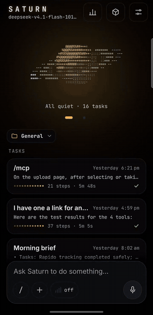

<p align="center">
  
</p>

<h1 align="center">Saturn</h1>

<p align="center"><b>A real coding agent, in your pocket.</b><br>
You tell it what you want. It goes off and does it, right there on your phone.</p>

<p align="center">
  
  <br><sub>One ask, about a minute, real phone. <a href="docs/media/saturn-demo.mp4">Full-quality video</a></sub>
</p>

---

Most AI apps on your phone are a chat box. You ask, it answers, and that's it.

Saturn actually does the work. It runs the [Pi coding agent](https://pi.dev) on the phone itself, with a shell, node, git and the usual tools built in. Ask it to build a small web app, sort a folder of PDFs, fix a bug in your repo or turn the torch off in ten minutes, then put the phone in your pocket. When it's done, the task card on your home screen has a tick.

No root. No Termux. No server of ours in the middle. Install it, pick a model, go.

## What it's like

**Each request is a task.** Start a few at once. While Saturn works, a little moon circles the card. When it finishes, the card shows how long it took, how many steps it ran and what it made.

**It makes things you keep.** Web pages, notes, reports and scripts land in **Artifacts**, ready to open or share.

**It knows it's on a phone.** It can use the torch, camera, mic, location, sensors, notifications and contacts, and speak out loud. The commands are Termux:API-compatible, so old scripts still work.

**It keeps time.** "Remind me at 6" or "check this every morning" really happens, even when the app is closed.

**It reaches further when you want.** It has a built-in browser you can watch it use, GitHub sign-in so it can clone, commit and open PRs, and SSH, so your laptop or server can do the heavy lifting.

**It fits into Android.** You can share anything to it from any app, reply to a finished task from the notification, use the home-screen widget or the quick-settings tile, or just talk to it.

**Any model you like.** Sign in with ChatGPT, Claude, Copilot and others, paste an API key, or use a free OpenRouter key to start.

And if you want to poke around yourself, there's a real terminal.

## Your stuff stays yours

Saturn has no accounts, no ads, no analytics and no server of its own. Your files, keys and projects live in the app's private storage.

The only thing that leaves the phone is what the agent sends to the AI provider *you* picked, so the model can think. Details are in [PRIVACY.md](PRIVACY.md).

## Get it

Download the APK from [Releases](../../releases). You'll need Android 10 or newer on a 64-bit ARM phone, which is pretty much any phone from the last few years.

Open it, follow the short setup and give it something to do.

## Want it to tap through your other apps?

That's a separate, opt-in app: [Phone Control](https://github.com/gouravraghuwanshi/phone-control-mcp). It's a small MCP server with a big Stop button and Allow prompts for anything risky, and it will never touch passwords or the lock screen. Saturn itself never uses the Accessibility API.

## How it works

Android won't run programs from an app's own storage, but it happily loads native libraries shipped inside the APK. So Saturn ships node, bash, git and friends (built by the Termux project) as `lib*.so` files and links them into a tiny Linux-style folder at startup.

Each task is its own `pi --mode rpc` process, and the Compose UI talks to it in JSON. Phone features go through a local, token-protected bridge back into the app.

## Build it yourself

```sh
python3 -I runtime/import_termux.py   # toolchain -> jniLibs + assets (sha256-verified)
runtime/build-pi-bundle.sh            # official Pi from npm -> assets/pi-bundle.zip
./gradlew assembleGithubRelease
```

You'll need JDK 17, the Android SDK (platform 37, NDK r29) and Node/npm.

There are two flavors from one codebase. `github` is the full app. `play` follows Google Play's rules: no contacts, and no native add-ons in npm packages. See [RELEASING.md](RELEASING.md) and [store/PLAY_STORE.md](store/PLAY_STORE.md).

## Contributing

Bug reports, ideas and pull requests are all welcome. If something broke, the most useful thing you can send is what you asked Saturn to do and what happened.

## Thanks

Saturn stands on other people's great work: [Pi](https://pi.dev) by Earendil Works, [Node.js](https://nodejs.org), [npm](https://github.com/npm/cli), the [Termux](https://github.com/termux) packages and terminal view, and the Inter and JetBrains Mono fonts. See [THIRD_PARTY.md](THIRD_PARTY.md). Saturn isn't affiliated with Earendil Works or Termux.

## License

[Apache-2.0](LICENSE) for Saturn's own code. Bundled pieces keep their own licenses.
