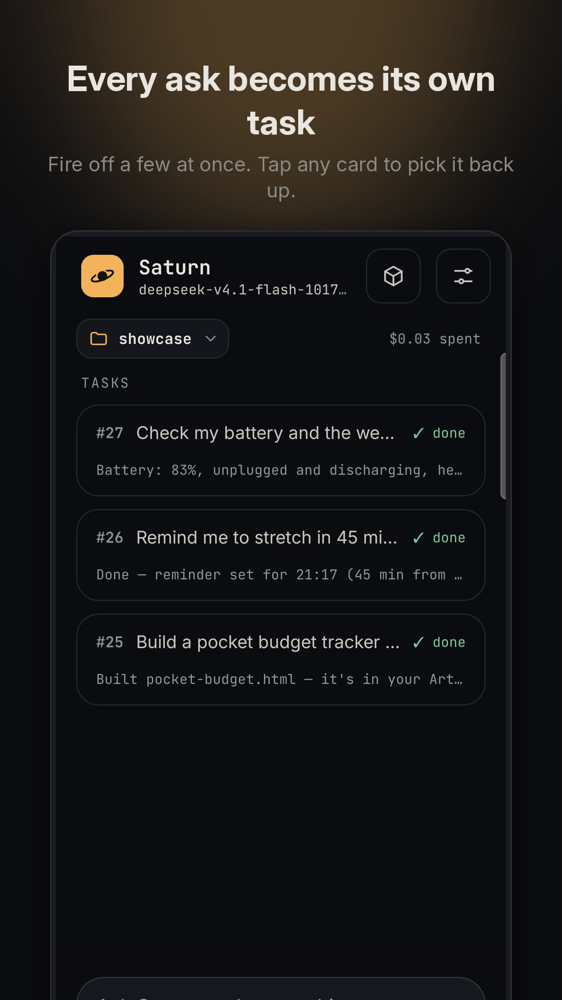
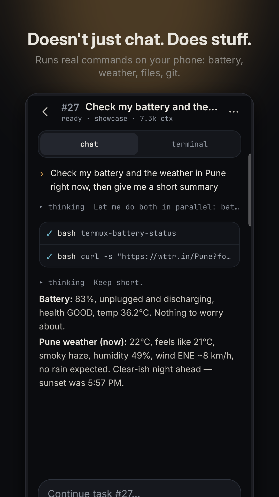
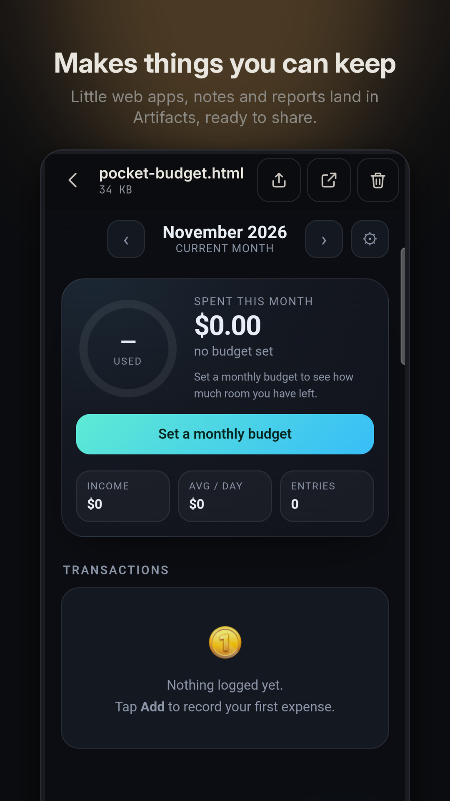
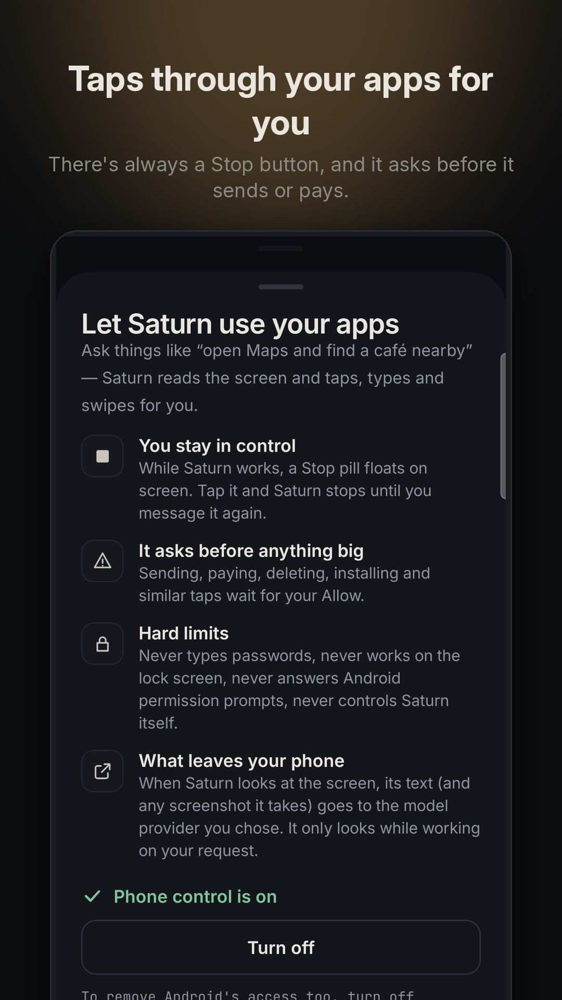

<p align="center">
  
</p>

<h1 align="center">Saturn Agent</h1>

<p align="center"><b>An AI agent that lives on your phone.</b><br>
The real <a href="https://pi.dev">Pi coding agent</a>, running on Android, with its own little Linux toolbox.</p>

<p align="center">
  
  
  
  
</p>

---

Most "AI on your phone" apps are a chat box that ships everything off to a server. Saturn is different: it runs the actual, unmodified Pi agent on your phone, with bash, node, npm, git, curl and ripgrep packed into the app. You pick the AI model (OpenRouter, Claude, ChatGPT, Gemini, DeepSeek… whatever you like) and Saturn does the work, on your phone.

No root. No Termux. Just install it.

## What it can do

- **Every request becomes a task.** Kick off a few at once, come back later, tap a card to keep going.
- **It makes things you can keep.** Small web apps, notes, reports and scripts end up in **Artifacts**, ready to open or share.
- **It can use your phone:** torch, camera, mic, battery, location, notifications, text-to-speech, sensors, contacts and sharing. The commands are Termux:API-compatible, so scripts written for Termux just work.
- **Timers and cron jobs.** "Turn the torch off in 10 minutes" really happens, even with the app closed.
- **It can tap through your other apps** (opt-in). A Stop button floats on screen the whole time. It asks before it sends, pays, deletes or installs anything, and it flat-out refuses password fields, the lock screen and permission prompts.
- **A built-in browser** the agent drives while you watch. You can take over any time.
- **Photos and files.** Attach images, PDFs, docs, spreadsheets, whatever.
- **Branch a chat** to try another idea without losing the original.
- **Extensions from pi.dev** with one tap, plus every Pi slash command.
- **A real terminal** when you want to poke around yourself.

## Your stuff stays yours

Saturn is open source and has no server of its own. No accounts, no ads, no analytics. Your files and projects live in the app's private storage, API keys are encrypted with the Android Keystore, and nothing gets backed up to the cloud.

The one thing that leaves your phone is what the agent sends to the AI provider you picked, so the model can think. That's how every AI agent works, and we'd rather tell you upfront. More detail in [PRIVACY.md](PRIVACY.md).

## Install

Grab the latest APK from [Releases](../../releases). Android 10 or newer, 64-bit ARM (basically any phone from the last few years).

Then open Saturn, tap **Sign in**, and either log in with a subscription you already have or paste an API key. OpenRouter has free models if you just want to try it.

> Turning on "Let Saturn use your apps" on Android 13+: if the switch is greyed out ("restricted setting"), open *App info → ⋮ → Allow restricted settings* first. Android does that to every app installed from a file. Saturn walks you through it.

## How it works (the short version)

Android won't let apps run programs from their own storage, but it *does* run native libraries shipped inside the APK. So Saturn packs node, bash, git and friends (built by the Termux project) as `lib*.so` files and links them into a small Linux-style `usr/` folder when it starts. Each task is its own `pi --mode rpc` process; the Compose UI talks to it over JSON. Phone features and app control go through a local, token-protected bridge back into the app. More in [RELEASING.md](RELEASING.md) and the source.

## Build it yourself

```sh
python3 -I runtime/import_termux.py   # toolchain -> jniLibs + assets (sha256-verified)
runtime/build-pi-bundle.sh            # official Pi from npm -> assets/pi-bundle.zip
./gradlew assembleDebug
```

You'll need JDK 17, the Android SDK (platform 37, NDK r29), and Node/npm on the build machine.

## Credits

Saturn stands on a lot of great open source work: [Pi](https://pi.dev) by Earendil Works (MIT), [Node.js](https://nodejs.org), [npm](https://github.com/npm/cli), the [Termux](https://github.com/termux) packages and terminal view, and the Inter and JetBrains Mono fonts. See [THIRD_PARTY.md](THIRD_PARTY.md).

Saturn isn't affiliated with Earendil Works or the Termux project.

## License

Saturn's own code is [Apache-2.0](LICENSE). Bundled components keep their own licenses.
